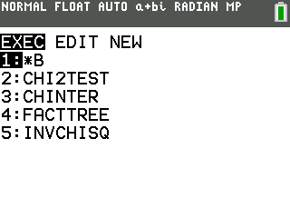

# CHI2TEST — Chi-Squared Variance Test

## Description

A one-sample chi-squared hypothesis test for a population variance or standard deviation. Mimics the interface of the built-in Z-Test and T-Test on the TI-84.

Tests H₀: σ = σ₀ (null std dev) against a chosen alternative. The test statistic is χ² = (n-1)·s² / σ₀², with df = n-1.

Enter the program line by line using the `PRGM` button on your calculator.

**Suggested program name:** `CHITEST`

## Program in Action



**Notes on special characters:**

| Character | Location |
|-----------|----------|
| `χ²cdf`, `χ²pdf`, `Shadeχ²` | `2nd` > `DISTR` (or `DRAW` > `SHADE` for `Shadeχ²`) |
| `solve(` | `MATH` > `Solver...` or `CATALOG` |
| `Menu(` | `PRGM` > `CTL` |
| `≠` | `2nd` > `TEST` (`2nd` > `MATH`) |
| `→` | The `STO>` key (below the `DEL` key) |
| `^` | The caret key for exponents |

## Code

```
ClrHome
Disp "CHI-SQ VAR TEST"
Input "NULL STD DEV?",S
Input "SAMP STD DEV?",A
Input "SAMPLE SIZE?",N
Input "ALPHA?",Q
(N-1)→D
(N-1)*A^2/S^2→C
χ²cdf(0,C,D)→U
1-U→V
Menu("ALTERNATIVE","≠ STD DEV",1,"< STD DEV",2,"> STD DEV",3)

Lbl 1
2*min(U,V)→P
max(0,min(1,P))→P
Q/2→W
solve(χ²cdf(0,T,D)-W,T,D/2)→L
solve(χ²cdf(T,10^99,D)-W,T,D+2*√(2*D))→R
1→H
Goto 4

Lbl 2
U→P
max(0,min(1,P))→P
solve(χ²cdf(0,T,D)-Q,T,D/2)→L
0→R
2→H
Goto 4

Lbl 3
V→P
max(0,min(1,P))→P
0→L
solve(χ²cdf(T,10^99,D)-Q,T,D+2*√(2*D))→R
3→H

Lbl 4
Menu("RESULTS","CALCULATE",5,"DRAW",6)

Lbl 5
ClrHome
Output(1,1,"CHI-SQ TEST")
Output(2,1,"χ²=")
Output(2,4,C)
Output(3,1,"p=")
Output(3,3,P)
Output(4,1,"df=")
Output(4,4,D)
Output(5,1,"a=")
Output(5,3,Q)
Output(6,1,"Lχ²=")
If H=3
Output(6,5,"NA")
If H≠3
Output(6,5,L)
Output(7,1,"Rχ²=")
If H=2
Output(7,5,"NA")
If H≠2
Output(7,5,R)
Output(8,1,"n=")
Output(8,3,N)
Pause 
Stop

Lbl 6
If D>2
Then
1.4*χ²pdf(D-2,D)→Ymax
Else
1.5→Ymax
End
0→Xmin
max(max(D+4*√(2*D),1.1*C),1.1*R)→Xmax
0→Ymin
ClrDraw
AxesOn 
If H=2
Then
Shadeχ²(0,L,D)
End
If H=3
Then
Shadeχ²(R,Xmax,D)
End
If H=1
Then
Shadeχ²(0,L,D)
Shadeχ²(R,Xmax,D)
End
Pause 
ClrHome
Output(1,1,"CHI-SQ TEST")
Output(2,1,"χ²=")
Output(2,4,C)
Output(3,1,"p=")
Output(3,3,P)
Output(4,1,"df=")
Output(4,4,D)
Output(5,1,"a=")
Output(5,3,Q)
Output(6,1,"Lχ²=")
If H=3
Output(6,5,"NA")
If H≠3
Output(6,5,L)
Output(7,1,"Rχ²=")
If H=2
Output(7,5,"NA")
If H≠2
Output(7,5,R)
Output(8,1,"n=")
Output(8,3,N)
Pause 
Stop
```

## How It Works

**Inputs:**

| Variable | Prompt | Meaning |
|----------|--------|---------|
| `S` | `NULL STD DEV` | Hypothesized population standard deviation (σ₀) |
| `A` | `SAMP STD DEV` | Sample standard deviation (s) |
| `N` | `SAMPLE SIZE` | Sample size (n) |
| `Q` | `ALPHA` | Significance level (α) |

**Test statistic:** χ² = (n-1)·s² / σ₀²

**Degrees of freedom:** df = n − 1

**P-value by alternative hypothesis:**

| Alternative | Type | Formula |
|-------------|------|---------|
| `≠` | Two-tailed | p = 2 · min(χ²cdf(0, χ², df), χ²cdf(χ², ∞, df)) |
| `<` | Left-tailed | p = χ²cdf(0, χ², df) |
| `>` | Right-tailed | p = χ²cdf(χ², ∞, df) |

For **DRAW**: the shaded region is the p-value area on the χ² curve. For the two-tailed case, both equal-area tails are shaded. After pressing `ENTER` on the graph, the numeric results are displayed.

**Variable usage:**

| Variable | Meaning |
|----------|---------|
| `S` | Null std dev (σ₀) |
| `A` | Sample std dev (s) |
| `N` | Sample size |
| `H` | Alternative type (1=≠, 2=<, 3=>) |
| `C` | Chi-squared test statistic |
| `D` | Degrees of freedom |
| `P` | P-value |
| `T` | Solver variable |

## Test Inputs

Use these values to verify your program is working correctly.

**Case 1:** H₀: σ = 10, s = 12, n = 25 → df = 24, χ² = 34.56

| Alternative | Expected p-value |
|-------------|-----------------|
| ≠ | ≈ 0.1527 |
| < | ≈ 0.9237 |
| > | ≈ 0.0763 |

**Case 2:** H₀: σ = 5, s = 4, n = 21 → df = 20, χ² = 12.8

| Alternative | Expected p-value |
|-------------|-----------------|
| ≠ | ≈ 0.2334 |
| < | ≈ 0.1167 |
| > | ≈ 0.8833 |
